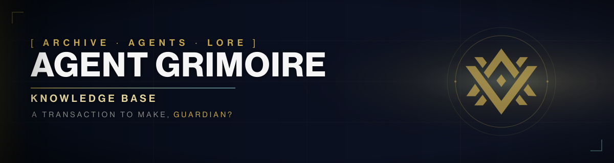

# Destiny Agent Grimoire

<p align="center">
  
</p>

<p align="center">
  
  <a href='https://github.com/sagaciouszu/destiny-agent-grimoire/actions/workflows/ci.yml'></a>
  
  
  
  
</p>

**Version:** 0.42.1 | **Last push:** 2026-11-12 | **Status:** Active

**Documentation site:** <https://sagaciouszu.github.io/destiny-agent-grimoire-site/>

**Limits and provenance:** <https://sagaciouszu.github.io/destiny-agent-grimoire-site/grimoire/limits/>

One canonical, agent-first Destiny lore archive: a single SQLite database with
FTS5 search, built from committed sources, with a documented quote policy and
verification gates. No external services at runtime.

## Quick start for Guardians

**Step 1: clone.**

```bash
git clone https://github.com/sagaciouszu/destiny-agent-grimoire.git
cd destiny-agent-grimoire
```

**Step 2: get the database. Run exactly one of these.**

Download the prebuilt release asset (seconds):

```bash
curl -fsSL https://github.com/sagaciouszu/destiny-agent-grimoire/releases/latest/download/grimoire.db -o db/grimoire.db
```

The agent installers verify the download against the release `SHA256SUMS`.

Smaller companions of the same bytes are published by the release-assets
workflow at the same static endpoint:

```bash
# 40.6 MiB, smallest: xz -d
curl -fsSL https://github.com/sagaciouszu/destiny-agent-grimoire/releases/latest/download/grimoire.db.xz -o db/grimoire.db.xz && xz -d db/grimoire.db.xz

# 72.6 MiB, zero dependencies: gzip -d (Android apps: GZIPInputStream)
curl -fsSL https://github.com/sagaciouszu/destiny-agent-grimoire/releases/latest/download/grimoire.db.gz -o db/grimoire.db.gz && gzip -d db/grimoire.db.gz
```

Or build a **core build** from this checkout (about two minutes, but it does
NOT produce the same database asset as a release):

```bash
python3 db/migrate.py
```

It leaves out the manifest-derived tables (`seals`) and the lore index. For a faithful local
build you additionally need the authoritative dump via `BUNGIE_API_KEY` and
the enrich chain:

```bash
python3 archive/data/fetch_manifest.py --check
python3 db/migrate.py
python3 scripts/apply-queen-fold.py
python3 db/enrich_lore.py
python3 db/enrich_seals.py
python3 db/build_entity_web.py --db db/grimoire.db
```

**Step 3: query.**

```bash
python3 db/query.py stats
python3 db/query.py search "Crota" --limit 5
```

**Optional: MCP clients.** Install the typed tool adapter once:

```bash
bash mcp-server/install.sh
```

It prints a client config snippet pointing at `mcp-server/run.sh`. Details and
the tool list: `mcp-server/README.md`.

More commands are in the sections below.

## Requirements

| Requirement | Needed for | Notes |
|---|---|---|
| `curl` | optional prebuilt database | otherwise build locally |
| `git` | cloning and version history | |
| MCP SDK (optional) | typed tools for agents without a shell | Python 3.10+; `bash mcp-server/install.sh` |
| `python3` 3.8+ | migration, query CLI, tests | standard library only |
| `sqlite3` | optional raw SQL | the CLI uses Python's built-in driver |
| ~400 MB disk | sources plus built database | database is ~260 MB |

No API keys, accounts or network access are required at runtime.

## What is inside

| Table | Rows | Purpose |
|---|---|---|
| `activities` | 71 | Raids, dungeons, seasonal activities and missions |
| `book_entries` | 1158 | Lore entries within books |
| `books` | 110 | Book-level metadata |
| `caption_provenance` | 56119 | Caption line provenance (hash, package, entry) |
| `caption_sightings` | 63359 | Every observation of a caption record line (build, package, slot) |
| `character_lines` | 1229 | Quote-ready character lines |
| `characters` | 20 | Curated character index |
| `coverage_notes` | 10 | Explicit status for zero-coverage gaps |
| `document_classification` | 179 | Season/event per book and record |
| `entities` | 89 | Named characters, powers, factions and places |
| `entity_aliases` | 136 | Attested name variants per entity |
| `entity_build_meta` | 14 | Entity web build audit trail |
| `entity_links` | 33578 | Entity to document links (attribution/canonical/alias/ctx) |
| `entity_relations` | 4 | Entity to entity links (adjacency, primeval pairs) |
| `event_occurrences` | 72 | Event year, dates and season |
| `events` | 9 | Rotating events including removed ones |
| `expansions` | 18 | Major releases from Destiny 1 through Renegades |
| `fts` | 176794 | FTS5 index over all content |
| `grimoire_cards` | 2889 | Destiny 1 grimoire cards |
| `interactions` | 2699 | Short dialogue beats |
| `item_classification` | 58764 | Season/event per item |
| `item_title_fts` (index) | 58764 | Item title lookup |
| `items` | 58764 | Weapons, armor and gear lore |
| `lore_entries` | 2962 | Bungie manifest lore entries (local enrichment) |
| `lore_entry_items` | 2068 | Lore entry to item-title links |
| `records` | 69 | Triumphs and seals |
| `seal_records` | 1004 | Triumph records per seal |
| `seals` | 70 | Manifest seal nodes |
| `seasons` | 28 | Official numeric seasons; 24-26 are episodes |
| `speaker_aliases` | 57 | Alias to canonical speaker mapping |
| `transcript_classification` | 9229 | Activity/season/event per transcript |
| `transcript_lines` | 125324 | Canon dialogue (speaker, line) |
| `transcripts` | 9229 | Transcript headers |
| `v_activity_coverage` (view) | 71 | Transcripts and lines per activity |
| `v_canon_speakers` (view) | 230 | Persona-canon speakers (excludes caption-only, optional-only and stage rows) |
| `v_entity_coverage` (view) | 4 | Per-kind entity web coverage |
| `v_entity_documents` (view) | 33578 | Entities with ranked document lists |
| `v_entity_resolve` (view) | 136 | Resolver lookup (alias to entity) |
| `v_event_coverage` (view) | 9 | Transcripts, lines and occurrences per event |
| `v_season_coverage` (view) | 28 | Transcripts and lines per season |
| `v_speakers` (view) | 423 | Speakers with line counts (includes caption-only) |
| `v_transcript_taxonomy` (view) | 9229 | Transcripts joined to classification |
| **Total** | 708597 | Rows across every table, view and index above |

Every content row carries provenance. Speaker aliases are canonicalized during
migration. The full contract is `STANDARDS.md`.

## For agents

- **Wiki:** `docs/wiki/Home.md` covers setup, query CLI, MCP,
  agents, platforms and troubleshooting.
- **Skill:** `skills/destiny-grimoire/SKILL.md` is the drop-in agent skill.
- **MCP (optional):** `mcp-server/run.sh` serves typed tools to non-shell clients
  over local stdio; one adapter covers every agent that mounts this archive.
  Install with `bash mcp-server/install.sh`; tools, limits, client config and
  security: `mcp-server/README.md`.
- **Interface:** one of `python3 db/query.py search|character|item|verify|book|transcript|find-item|record|list|activity|event|lore|seal|seals|coverage|stats|entity`; read commands accept `--offset`.
  `verify` is the quote-safety primitive (exit 1 when absent); every command
  accepts `--json`; search returns snippets unless `--full`.
- **Entity web:** `python3 db/query.py entity "<name>"` resolves any attested alias to its entity (characters, powers, factions, places) and reports aliases, document counts, top documents and relations. `entity` also powers `search --entity <name>`.
- **Discovery:** `db/capabilities.json` is a machine-readable manifest of tables,
  views, commands and contracts.
- **Search surface:** FTS5 with a `source` column for exact type filters and
  optional `--activity`, `--season`, `--event`, `--expansion` and `--class` facets.
- **Taxonomy:** `docs/TAXONOMY.md` defines the expansion/season/activity/event
  model, confidence levels and query examples.
- **Lore:** `python3 db/query.py list lore` and `lore <hash|title>` expose the
  Bungie manifest lore corpus.
- **Gap ledger:** `docs/GAPS.md` lists activities, events and speakers still
  waiting on a source.
- **Discovery design:** `docs/DISCOVERY.md` explains why the layer is additive,
  how filters compile, and measured query times.
- **Policy:** `STANDARDS.md` defines schema, naming, provenance, quote policy and
  verification gates.
- **Never** parse `source/` markdown at runtime. Query the database.
- **Output budget:** always pass `--limit`; assume 20 to 40 lines per call.

Connection matrix:

| From | To | Mechanism |
|---|---|---|
| agent repos | this archive | `lore/` symlink or clone, then `lore/db/query.py` |
| MCP client | this archive | `mcp-server/run.sh` (stdio, read-only) |
| release workflow | consumers | `grimoire.db` attached to each release, checksum verified |
| agent `setup.sh` | this archive | clone or symlink, download or build the database |

## Repository layout

```
db/          # query.py, schema.sql, migrate.py, taxonomy.py, capabilities.json
source/      # ingested markdown: books, cards, transcripts, records, items, interactions
compendium/  # character quote index that feeds the characters tables
archive/     # raw scraper output (JSONL) and fetchers
scripts/     # ingestion helpers
tests/       # archive gates, agent suites, shared runner, conformance
docs/        # wiki, taxonomy, discovery design and coverage ledger
skills/      # agent-facing SKILL.md
series/      # registry of grimoire-born agents (ids, source repos, peers)
mcp-server/  # optional MCP adapter (stdio, read-only)
index.md     # short pointer to the database
STANDARDS.md # the contract: schema, naming, provenance, gates, README rules
```

## Maintenance

```bash
# ingest more content (Ishtar page ranges, caption fetchers)
python3 archive/scrape.py interactions <start> <end>
python3 archive/scrape.py items <start> <end>
python3 archive/data/fetch_transcripts_web.py
python3 archive/data/fetch_cutscenes.py
python3 archive/data/fetch_transcript_releases.py   # authoritative Added In releases

# optional: authoritative Bungie manifest (needs BUNGIE_API_KEY)
python3 archive/data/fetch_manifest.py --check
python3 archive/data/fetch_manifest.py --fetch --extract

# rebuild, then apply local manifest enrichment
python3 db/migrate.py
python3 scripts/apply-queen-fold.py
python3 db/enrich_lore.py
python3 db/enrich_seals.py
python3 db/build_entity_web.py --db db/grimoire.db
python3 scripts/export-site-stats.py \
  --out ../destiny-agent-grimoire-site/_data/grimoire.json   # site counts
python3 tests/sync-doc-counts.py
python3 tests/sync-readme-meta.py
python3 scripts/coverage-report.py

# verify everything
bash grimoire-master-audit.sh
# per-agent audits live in each agent repo: bash tests/master-audit.sh

# stage a release (copy, checksums, publish commands), backup, sync agents
bash scripts/release-stage.sh <version>
bash scripts/backup.sh
bash scripts/sync-live-agents.sh

# release the database as an asset (digest checked against local sha256)
gh release upload <tag> db/grimoire.db SHA256SUMS --clobber
```

The change procedure is section 10 of `STANDARDS.md`. A rolling backup of the
repository minus the database lives outside the tree.

## Verification

| Suite | Command | Expected |
|---|---|---|
| Agent access | `python3 tests/agent-access-test.py` | PASS |
| Agent layout | `bash tests/agent-layout-test.sh` | 108 checks |
| Agent suite manifests | `python3 tests/suite-manifest-test.py` | PASS |
| Agnostic contract | `python3 tests/agnostic-test.py` | PASS |
| Archive audit | `bash grimoire-master-audit.sh` | 18/18 |
| Calus / Zavala / Ghost / Mara Sov | run tests/master-audit.sh in each repo | 20/20 |
| Cutscene captions | `bash tests/cutscene-verify.sh` | 6/6 checks |
| Database integrity | `bash tests/test-db.sh` | 67 checks |
| Drifter agent audit | run tests/master-audit.sh in destiny-agent-drifter | 27/27 |
| Eris agent audit | run tests/master-audit.sh in destiny-agent-eris-morn | 22/22 |
| Documentation consistency | `python3 tests/docs-consistency.py` | PASS |
| File conformance | `python3 tests/conformance.py` | PASS |
| Knowledge webs | `python3 scripts/generate-knowledge-web.py --check` | PASS |
| MCP contract | `mcp-server/.venv/bin/python tests/mcp-test.py` | 12/12 checks |
| Query interface | `bash tests/query-interface-test.sh` | 97 checks |

Agent audits run from their own repos and call shared gates through
`lore/tests/`; the archive audit is shared-only.

## License and attribution

MIT licensed. Fan-made. Not affiliated with or endorsed by Bungie.

### Licensing

- Original code, tests and documentation are MIT licensed; see `LICENSE`.
- Destiny lore, text, characters and art belong to Bungie. No license is granted
  to Bungie IP.
- This is a fan-made, non-commercial project; `NOTICE` records the split.

- **Destiny 1 and Destiny 2** content and related intellectual property belong to Bungie.
- **Ishtar Collective** (https://www.ishtar-collective.net): the primary text
  archive; their transcription work is the foundation this project rests on.
- **Destiny Lore Vault** (https://www.youtube.com/@DestinyLoreVault): the recording
  archive; their videos keep the performances behind the words alive.
- **Destinypedia** (https://www.destinypedia.com): bootstrap source for specific dialogue.
- **Destiny community**: transcription, analysis and preservation, with
  **special thanks to every Guardian making their own fate in 2026 and beyond**.

All the community projects out there are continual labors of love. Neither this
archive nor the community around it would exist without the efforts of everyone
who has worked on Destiny.

Cutscene transcripts come from YouTube captions (auto-generated, corroboration
verified). Content and provenance are documented in `STANDARDS.md`.
